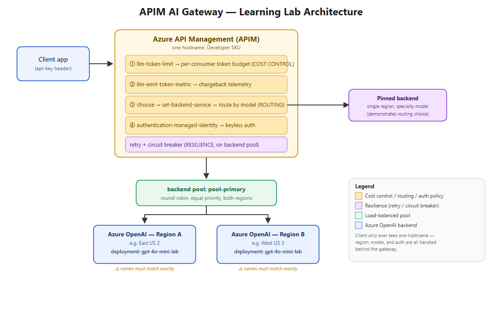

# APIM AI Gateway — a 2-hour beginner lab

Learn **Azure API Management (APIM) as an AI gateway** in front of Azure OpenAI by
building a small but real one: cost control, multi-region resilience, and
multi-model routing — the three things every team hits the moment more than one
app calls an LLM.

No prior APIM experience required. Basic familiarity with the Azure Portal and
PowerShell (or willingness to copy/paste commands) is enough.

**Time:** ~2 hours, mostly waiting on Azure provisioning (APIM takes 20–40 min to
create, which is why Step 1 kicks it off first and you do other work while it bakes).

**Cost:** ~$2–4 for the lab if you tear it down same-day (APIM Developer SKU is
~$0.07/hour; Azure OpenAI is pay-per-token and this lab makes ~30 small calls).
See [teardown](docs/TUTORIAL.md#8-teardown-dont-skip-this) — do not leave the lab running.

## What you'll build

Full diagram and explanation: [docs/ARCHITECTURE.md](docs/ARCHITECTURE.md)

## Start here

1. **[docs/ARCHITECTURE.md](docs/ARCHITECTURE.md)** — read this first (10 min). What
   an AI gateway is, why each policy exists, and the vocabulary used in the tutorial.
2. **[docs/TUTORIAL.md](docs/TUTORIAL.md)** — the step-by-step build (the other
   ~110 minutes). Portal + PowerShell, copy-paste friendly, one section at a time.

## Repo layout

| Path | What it is |
|---|---|
| `docs/ARCHITECTURE.md` | Concepts + diagram — read before building |
| `docs/TUTORIAL.md` | Step-by-step lab instructions |
| `scripts/` | PowerShell scripts the tutorial calls, parameterized — no hardcoded names |
| `policies/api-inbound.xml` | The finished APIM policy, fully commented |
| `LICENSE` | MIT |

## Prerequisites

- An Azure subscription where you can create resources (a free trial or sandbox
  subscription is fine — this lab fits comfortably in free-tier credit)
- [Azure CLI](https://learn.microsoft.com/cli/azure/install-azure-cli) installed
  and `az login` working
- PowerShell 7+ (Windows, macOS, or Linux)
- Access to create Azure OpenAI resources in your subscription (some tenants
  require a one-time access request — see Step 2 in the tutorial if `az cognitiveservices`
  calls are rejected)

## Learning outcomes

By the end you will be able to explain and demonstrate:

- **Cost control** — why "enforce a budget before the call" beats "review the bill
  after," and how `llm-token-limit` does it
- **Resilience** — how one hostname can round-robin across two regions, and why
  *deployment names must match exactly* for that to work (the #1 beginner trap)
- **Multi-model routing** — how a single gateway can front multiple models without
  client apps knowing or caring which one answers
- **Keyless auth** — why managed identity is preferable to distributing API keys

## License

MIT — see [LICENSE](LICENSE). Use it, fork it, teach with it.
